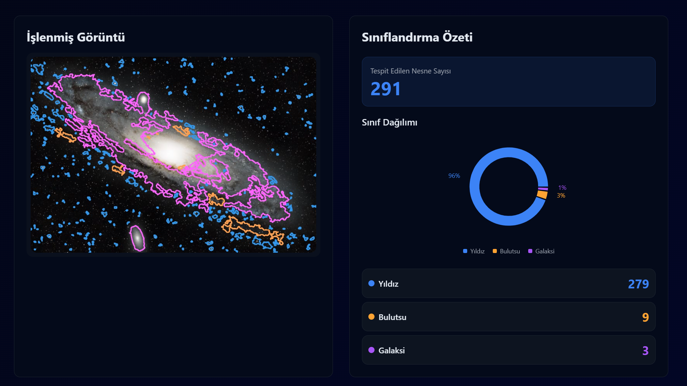

# Astro Classifier (Astronomical Object Classifier)

> **A full-stack web app that analyzes deep-space photos, detects celestial objects and classifies them.**


<p align="center">
  
</p>

<!-- TODO: demo GIF -->

## About the Project

I built this project to take amateur or professional astronomy photos and sort the objects in them into classes such as **Star, Galaxy, Nebula and Planet**. It's an end-to-end solution: you upload a photo, and you get the classified objects back.

The backend is a Python (Flask) image processing service, and the frontend is a space-themed React (Vite) interface.

### Main Features

* **Object detection:** I use OpenCV to separate light sources from the background and split them into segments.
* **Classification:** a trained **RandomForest (v2)** model assigns each object to one of 6 classes.
* **Color-coded results:** it draws a frame around each detected object in a color that depends on its class (for example Galaxy = purple, Star = blue).
* **Statistics:** shows the distribution in the image with an interactive donut chart and a detailed list.
* **Interface:** supports drag and drop, has a dark mode and a "glassmorphism" look.

---

## Technologies

### Backend


### Frontend


---

## Setup and Running

Here's how to run the project on your own machine.

### 1. Clone the repository

```bash
git clone https://github.com/tetwy/astro-siniflandirici.git
cd astro-siniflandirici
```

### 2\. Backend setup (Terminal 1)

First create a Python virtual environment and install the required libraries.

```bash
cd backend

python -m venv venv
# Activate on Windows:
venv\Scripts\activate
# Activate on Mac/Linux:
# source venv/bin/activate

# Install the dependencies
pip install flask flask-cors opencv-python scikit-learn pandas numpy joblib

# Only needed if you want to retrain the model (model_egitici.py):
# pip install matplotlib seaborn

# Start the API server
python image_service.py
```

*The backend runs at `http://localhost:5000` (the `/classify` endpoint). The trained v2 models are included in `backend/models`.*

### 3\. Frontend setup (Terminal 2)

Open a new terminal window and start the React app.

```bash
cd frontend

# Install the packages
npm install

# Start the app
npm run dev
```

*The frontend opens at `http://localhost:8080` (`frontend/vite.config.ts`) and talks to the API at `http://127.0.0.1:5000/classify`.*

### 4\. Retraining the model (optional)

```bash
# inside the backend/ folder
python star_detector.py   # extracts feature JSONs from the images in assets/ into outputs/features/
python veri_birlestir.py  # merges the labeled objects into eğitim_veriseti.csv
python model_egitici.py   # writes the v2 model into the models/ folder
```

-----

## Project Structure

```text
astro-siniflandirici/
├── backend/                 # Python API and AI models
│   ├── assets/              # Raw training images
│   ├── models/              # Trained .joblib models (v2)
│   ├── outputs/             # Debug images and feature JSONs created when star_detector.py runs (not tracked in git)
│   ├── image_service.py     # Flask API server (entry point)
│   ├── star_detector.py     # Image processing module
│   ├── model_egitici.py     # Model training script
│   └── veri_birlestir.py    # Dataset builder
│
├── frontend/                # React web interface
│   ├── src/                 # Source code
│   ├── public/              # Static files
│   └── ...                  # Config files
│
└── docs/                    # Documentation images
```

## License

This project is licensed under the **MIT License**.

The MIT License lets anyone who gets a copy of this software use, copy, modify, merge, publish, distribute, sublicense and/or sell it, with no restrictions.

See the [LICENSE](LICENSE) file for the full text.
